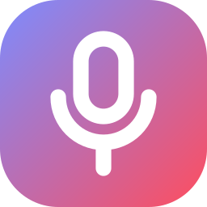
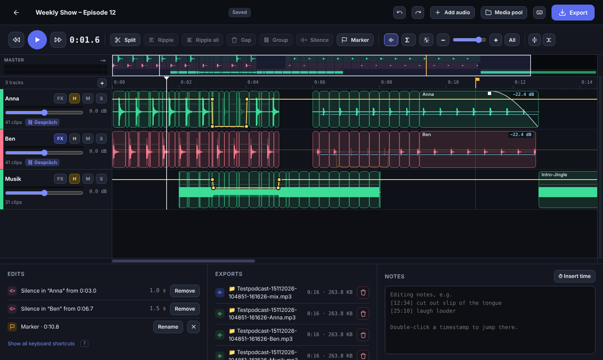

<p align="center"></p>

<h1 align="center">Remote Booth</h1>

<p align="center">
Selbst gehostetes Podcast-Studio im Browser – jeder Gast auf eigener Spur, mit Editor und Export.<br>
<a href="README.md">English version</a>
</p>



Remote Booth ist eine kleine, selbst gehostete Alternative zu Riverside oder Zencastr. Es läuft als ein Docker-Container auf einem Heimserver oder NAS (getestet auf einem Intel i3 ohne Grafikkarte mit ZimaOS) und braucht kein Cloud-Konto.

## Funktionen

**Aufnahme**
- Video- und Audiocall mit bis zu 4 Personen, direkt Browser zu Browser (WebRTC)
- **Jede Person wird lokal in voller Qualität aufgenommen**, als eigene MP3-Spur (128/192/256 kbit/s). Netz-Ruckler betreffen den Call, nicht die Aufnahme
- Dreifache Sicherung: live im Browser-Speicher, optional in einen Ordner auf dem eigenen Rechner (Chrome/Edge) oder als automatischer MP3-Download, und laufender Upload auf den Server, der nach Netz- oder Serverausfall weitermacht
- Videokacheln frei verschieben und vergrößern, Raster- und Fokus-Ansicht, Bildschirm teilen, Chat mit Dateien, Marker während der Aufnahme (Taste **K**)
- Für Smartphones und Tablets angepasst, Energiesparmodus für lange Aufnahmen im Akkubetrieb

**Editor**
- Mehrspur-Zeitachse mit Clips: Teilen, Ripple-Schnitt (gewählte oder alle Spuren), Löschen mit Lücke, Gruppen, Spurgruppen, Einrasten, Rückgängig/Wiederholen
- Zeitauswahl im Lineal wie in Reaper, Clip-Lautstärke per Ziehen, Fades aus den Clip-Ecken, Lautstärke-Hüllkurve pro Spur
- Effekte pro Spur: Noise Gate, 5-Band-EQ, Kompressor, Limiter – plus Limiter auf der Summe. Vorlagen (mitgeliefert und eigene, auf Wunsch automatisch für neue Aufnahmen), Live-Vorschau und A/B-Vergleich (Taste **B**)
- Spuren normalisieren (LUFS oder Spitzenpegel), Pegelanzeigen pro Spur und für die Summe
- **Mediapool** für Intros, Outros, Jingles und Soundeffekte, in jedem Projekt verfügbar
- Notizen mit anklickbaren Zeitstempeln; Bearbeitungen werden automatisch gespeichert und zwischen Geräten abgeglichen

**Export**
- MP3-Mix mit Lautheitsziel (z. B. −16 LUFS), Ein-/Ausblenden, auf Wunsch jede Spur einzeln (geschnitten und synchron) oder als Rohfassung ohne Effekte
- Läuft auf dem Server mit niedriger Priorität und parallel auf mehreren Kernen; **Vorschau und Export rechnen mit demselben Effekt-Code**, der Export klingt also genau wie im Editor
- Exporte landen in einem frei wählbaren Ordner, je Projekt ein Unterordner

**Server**
- Einrichtung beim ersten Aufruf: Passwort, Sprache und die Ordner für Aufnahmen, Exporte und Mediapool – ausgewählt mit einem eingebauten Ordner-Browser (auch Netzlaufwerke)
- Oberfläche auf **Deutsch und Englisch** (weitere Sprachen als eine Wörterbuch-Datei ergänzbar)
- Sparsam: Node.js + ffmpeg, keine Datenbank, ca. 50 MB RAM im Leerlauf

## Installation

### ZimaOS / CasaOS – App Store

1. Im ZimaOS App Store eine neue App-Quelle hinzufügen (Schaltfläche „Quelle hinzufügen“ bzw. Quellen-Einstellungen neben der Store-Liste) mit der Adresse  
   `https://cdn.jsdelivr.net/gh/Schnubbirunkel/Remote-Booth@gh-pages/store.json`
2. **Remote Booth** aus der neuen Quelle installieren.
3. App öffnen (Port **8090**). Die Einrichtung fragt nach Passwort, Sprache und Speicherorten.

### ZimaOS / CasaOS – eigene Installation

**App Store → ⋯ → Benutzerdefinierte Installation → Importieren** und den Inhalt von [`appstore/Apps/RemoteBooth/docker-compose.yml`](appstore/Apps/RemoteBooth/docker-compose.yml) einfügen.

Der Container sieht `/DATA` und `/media` unter denselben Pfaden wie ZimaOS. In der Einrichtung lässt sich deshalb jeder Ordner auf deinen Platten oder Netzlaufwerken auswählen.

### Beliebiger Docker-Host

```bash
git clone https://github.com/Schnubbirunkel/Remote-Booth.git
cd Remote-Booth
cp .env.example .env        # bei Bedarf anpassen
docker compose up -d
```

Dann `http://<server>:8090` öffnen. Ordner für Aufnahmen, Exporte oder Mediapool müssen in den Container eingebunden sein (siehe `STORAGE_PATH` und `BROWSE_ROOTS` in `.env.example`).

## HTTPS und Gäste von außen

Browser geben Kamera und Mikrofon **nur über HTTPS** frei (Ausnahme: `localhost`), und dein Gast muss den Server erreichen. Möglichkeiten, vom einfachsten Weg an:

- **Cloudflare Tunnel** (eigene Domain bei Cloudflare, keine Portfreigabe): `cloudflare/cloudflared` mit deinem Tunnel-Token starten und einen *Public Hostname* auf `http://<server-ip>:8090` zeigen lassen. WebSockets funktionieren automatisch.
- **Tailscale Funnel** (keine Domain, keine Portfreigabe): in `.env` `COMPOSE_PROFILES=tailscale` und `TS_AUTHKEY` setzen. Du bekommst `https://remote-booth.<tailnet>.ts.net`; Gäste brauchen kein Tailscale.
- **Eigene Domain + Portfreigabe 80/443**: `DOMAIN` und `COMPOSE_PROFILES=https` setzen – Caddy holt das Let's-Encrypt-Zertifikat automatisch.

Zum Testen im Heimnetz ohne HTTPS: in Chrome `chrome://flags/#unsafely-treat-insecure-origin-as-secure` öffnen, `http://<server-ip>:8090` eintragen und Chrome neu starten.

**Wenn der Call nicht verbindet** (strenge Firmen-Firewalls, manche Mobilfunknetze), braucht es einen TURN-Server: entweder den mitgelieferten coturn (`COMPOSE_PROFILES=turn`, `TURN_URL`, `TURN_SECRET`, `PUBLIC_IP` setzen, 3478 UDP/TCP und 49160–49200 UDP freigeben) oder einen fremden TURN-Dienst (`TURN_URL`/`TURN_USER`/`TURN_PASS` oder `ICE_SERVERS`). Die Aufnahme läuft in jedem Fall lokal weiter.

## Bedienung

1. **Übersicht**: Raum anlegen und Einladungslink kopieren. Nur der Host braucht das Passwort, Gäste nur den Link.
2. **Vorraum**: Name, Mikrofon und Kamera wählen. Empfehlung: **Kopfhörer**, Echounterdrückung an, Rauschfilter und Auto-Pegel aus.
3. **Aufnahme starten**: Ein Klick startet die Aufnahme bei allen. Jede Kachel zeigt „REC“ und den Upload-Status.
4. **Stoppen**: Restliche Daten werden hochgeladen („Auf Server gesichert ✓“). Unter **Backups** in der Seitenleiste lässt sich die eigene Spur jederzeit herunterladen.
5. **Bearbeiten** öffnet den Editor. Dort zeigt `?` alle Tastenkürzel.

**Einstellungen** (Zahnrad in der Übersicht): Sprache, Speicherorte und Passwort. Ein neuer Aufnahmeordner gilt für neue Aufnahmen; bestehende Projekte bleiben, wo sie sind, und weiterhin sichtbar. Der Mediapool zieht automatisch in seinen neuen Ordner um. Ist ein Netzlaufwerk gerade nicht eingebunden, landen neue Aufnahmen vorübergehend im App-Datenordner – auf einen leeren Einhängepunkt wird nie geschrieben.

## Konfiguration

Alles lässt sich in der Oberfläche einstellen. Umgebungsvariablen sind optional:

| Variable | Standard | Bedeutung |
|---|---|---|
| `APP_PASSWORD` | – | Festes Passwort (ersetzt das aus der Einrichtung) |
| `DEFAULT_LANGUAGE` | – | `de` oder `en` für Besucher ohne eigene Auswahl (sonst Browsersprache) |
| `BROWSE_ROOTS` | `/DATA,/media,/mnt,/srv` | Ordner, die der Ordner-Browser zeigen darf (der App-Datenordner ist immer dabei) |
| `EXPORT_CPU` | `80` | CPU-Anteil beim Export in Prozent aller Threads |
| `MAX_PEERS` | `4` | Maximale Personen pro Raum |
| `PUID` / `PGID` | – | Besitzer der Exportdateien; sonst für alle beschreibbar |
| `TZ` | `Etc/UTC` | Zeitzone |
| `STUN_URL`, `TURN_URL`, `TURN_SECRET`, `TURN_USER`, `TURN_PASS`, `ICE_SERVERS` | Google-STUN | WebRTC-Server |
| `CHAT_FILE_MAX_MB` | `2048` | Maximale Größe von Dateien im Chat |

## Browser

- **Chrome / Edge / Opera** am Computer (empfohlen): alle Funktionen inklusive Backup in einen Ordner (nur über https)
- **Brave**: wie Chrome; das Ordner-Backup unter `brave://flags/#file-system-access-api` einschalten
- **Firefox / Safari**: alles außer dem Ordner-Backup – stattdessen „Backup-MP3 automatisch herunterladen“ nutzen

## Weitere Sprache hinzufügen

1. `public/js/i18n/en.js` z. B. nach `fr.js` kopieren und die Werte übersetzen (die Schlüssel sind die deutschen Originaltexte).
2. In `public/js/i18n.js` unter `LANGS` eintragen.

## Lizenz

MIT – siehe [LICENSE](LICENSE). Fremdkomponenten: lamejs (LGPL-3.0), ws (MIT), FFmpeg (LGPL/GPL, im Docker-Image aus den Alpine-Paketen).
