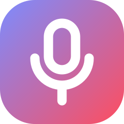
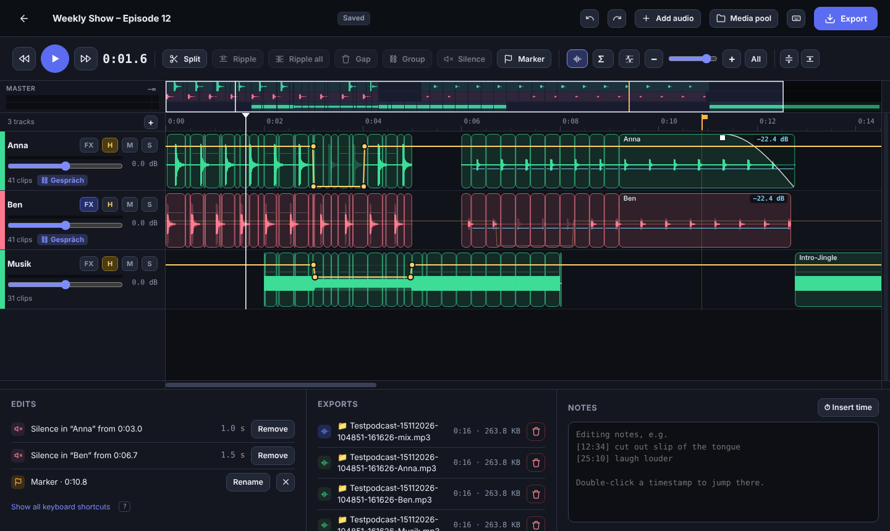

<p align="center"></p>

<h1 align="center">Remote Booth</h1>

<p align="center">
Self-hosted remote podcast studio in the browser – every guest on their own track, with editor and export.<br>
<a href="README.de.md">Deutsche Version</a>
</p>



Remote Booth is a small, self-hosted alternative to Riverside or Zencastr. It runs as one Docker container on a home server or NAS (tested on an Intel i3 without GPU, ZimaOS) and needs no cloud account.

## Features

**Recording**
- Video and audio call between up to 4 people, directly browser to browser (WebRTC)
- **Every person is recorded locally in full quality** as a separate MP3 track (128/192/256 kbps). A shaky connection affects the call, not the recording
- Triple safety net: live backup in browser storage, optional backup into a local folder (Chrome/Edge) or automatic MP3 download, and continuous upload to the server that resumes after network or server outages
- Movable and resizable video tiles, grid and focus view, screen sharing, chat with file sharing, markers during recording (key **K**)
- Mobile-friendly room (portrait and landscape), power-saving mode for long recordings on battery

**Editor**
- Multitrack timeline with clips: split, ripple cut (selected tracks or all), delete with gap, groups, track groups, snapping, undo/redo
- Reaper-like time selection in the ruler, clip volume by dragging, fades from the clip corners, volume envelopes per track
- Effects per track: noise gate, 5-band EQ, compressor, limiter – plus a master limiter. Presets (built-in and your own, optionally applied automatically to new recordings), live preview and A/B comparison (key **B**)
- Loudness normalisation of tracks (LUFS or peak), level meters per track and for the master
- **Media pool** for intros, outros, jingles and sound effects, available in every project
- Notes with clickable timestamps, edits are saved automatically and synchronised between devices

**Export**
- MP3 mix with loudness target (e.g. −16 LUFS), fade in/out, optionally every track separately (edited and in sync) or as a raw version without effects
- Rendered on the server at low priority and in parallel; **preview and export use the same DSP code**, so the export sounds exactly like the editor
- Exports land in a folder of your choice, one subfolder per project

**Server**
- Setup screen on first start: password, language and the folders for recordings, exports and media pool – chosen with a built-in folder browser (network shares included)
- Interface in **English and German** (more languages can be added as a single dictionary file)
- Lightweight: Node.js + ffmpeg, no database, ~50 MB RAM when idle

## Installation

### ZimaOS / CasaOS – app store

1. In the ZimaOS App Store, add a new app source (the “Add source” / source settings button next to the store list) with the URL  
   `https://cdn.jsdelivr.net/gh/Schnubbirunkel/Remote-Booth@gh-pages/store.json`
2. Install **Remote Booth** from the new store.
3. Open the app (port **8090**). The setup screen asks for a password, the language and the storage folders.

### ZimaOS / CasaOS – custom install

**App Store → ⋯ → Custom Install → Import** and paste the content of [`appstore/Apps/RemoteBooth/docker-compose.yml`](appstore/Apps/RemoteBooth/docker-compose.yml).

The container sees `/DATA` and `/media` under the same paths as ZimaOS, so you can pick any folder on your disks or network shares in the setup.

### Any Docker host

```bash
git clone https://github.com/Schnubbirunkel/Remote-Booth.git
cd Remote-Booth
cp .env.example .env        # adjust if needed
docker compose up -d
```

Open `http://<server>:8090`. Folders you want to use for recordings, exports or the media pool must be mounted into the container (see `STORAGE_PATH` and `BROWSE_ROOTS` in `.env.example`).

Or with plain Docker:

```bash
docker run -d --name remote-booth -p 8090:8080 \
  -v ./data:/data -v /srv/podcast:/storage \
  -e BROWSE_ROOTS=/storage \
  ghcr.io/schnubbirunkel/remote-booth:latest
```

Images are published for `linux/amd64` and `linux/arm64`.

## HTTPS and guests from outside

Browsers only allow camera and microphone over **HTTPS** (exception: `localhost`), and your guest must be able to reach the server. Options, from easiest:

- **Cloudflare Tunnel** (own domain at Cloudflare, no port forwarding): run `cloudflare/cloudflared` with your tunnel token and point a *public hostname* to `http://<server-ip>:8090`. WebSockets work out of the box. Cloudflare limits uploads to 100 MB per request – Remote Booth uploads in small chunks, so this is fine.
- **Tailscale Funnel** (no domain, no port forwarding): set `COMPOSE_PROFILES=tailscale` and `TS_AUTHKEY` in `.env`. You get `https://remote-booth.<tailnet>.ts.net`; guests do not need Tailscale.
- **Own domain + ports 80/443**: set `DOMAIN` and `COMPOSE_PROFILES=https` – Caddy fetches a Let's Encrypt certificate automatically.

For a quick test in your home network without HTTPS: open `chrome://flags/#unsafely-treat-insecure-origin-as-secure` in Chrome, add `http://<server-ip>:8090` and restart Chrome.

**If the call does not connect** (strict corporate firewalls, some mobile networks), a TURN server is needed: either the bundled coturn (`COMPOSE_PROFILES=turn`, set `TURN_URL`, `TURN_SECRET`, `PUBLIC_IP`, forward 3478 UDP/TCP and 49160–49200 UDP) or an external TURN service (`TURN_URL`/`TURN_USER`/`TURN_PASS` or `ICE_SERVERS`). The recording keeps running locally either way.

## Usage

1. **Dashboard**: create a room and copy the invite link. Only the host needs the password; guests only need the link.
2. **Lobby**: choose name, microphone and camera. Recommended: **headphones**, echo cancellation on, noise suppression and auto gain off.
3. **Start recording**: one click starts the recording for everyone. Each tile shows “REC” and the upload status.
4. **Stop**: remaining data is uploaded (“Saved on server ✓”). Under **Backups** in the sidebar you can download your own track at any time.
5. **Edit** opens the editor. Press `?` there for all keyboard shortcuts.

**Settings** (gear icon on the dashboard): language, storage folders and password. Changing the recordings folder applies to new recordings; existing projects stay where they are and remain visible. The media pool moves to its new folder automatically. If a network share is temporarily unavailable, new recordings are stored in the app data folder – nothing is ever written to an unmounted mount point.

## Configuration

All settings can be made in the web interface. Environment variables are optional:

| Variable | Default | Meaning |
|---|---|---|
| `APP_PASSWORD` | – | Fixed password (replaces the one from the setup screen) |
| `DEFAULT_LANGUAGE` | – | `de` or `en` for visitors without a stored choice (otherwise browser language) |
| `BROWSE_ROOTS` | `/DATA,/media,/mnt,/srv` | Folders the folder browser may show (the app data folder is always included) |
| `EXPORT_CPU` | `80` | CPU share for exports in percent of all threads |
| `MAX_PEERS` | `4` | Maximum people per room |
| `PUID` / `PGID` | – | Owner of exported files; otherwise they are writable for everyone |
| `TZ` | `Etc/UTC` | Time zone |
| `STUN_URL`, `TURN_URL`, `TURN_SECRET`, `TURN_USER`, `TURN_PASS`, `ICE_SERVERS` | Google STUN | WebRTC servers |
| `CHAT_FILE_MAX_MB` | `2048` | Maximum size of files shared in the chat |

Data in the app data folder (`/data` in the container): `settings.json`, `rooms.json`, `presets.json`, and – unless you chose other folders – `sessions/`, `exports/`, `library/`.

## Browsers

- **Chrome / Edge / Opera** on a computer (recommended): all features including backup into a local folder (https only)
- **Brave**: like Chrome; enable the folder backup under `brave://flags/#file-system-access-api`
- **Firefox / Safari**: everything except the folder backup – use “Automatically download a backup MP3” instead

## Adding a language

1. Copy `public/js/i18n/en.js` to e.g. `fr.js` and translate the values (the keys are the German source texts).
2. Register it in `public/js/i18n.js` (`LANGS`).

The interface is translated while it is displayed, so no other files need changes. Pull requests welcome.

## Development

```bash
npm install
npm start           # needs ffmpeg in PATH; data goes to ./data
```

```
server/index.js          HTTP API, WebSocket signalling, uploads, settings
server/audio.js          ffmpeg helpers, export pipeline
server/export-worker.js  effects and mixing in worker threads
public/js/dsp-core.js    gate, EQ, compressor, limiter, loudness meter – shared by preview and export
public/                  interface (no build step, no external CDNs)
```

Releases: raise `version` in `package.json`, update `RELEASE_NOTES.md` and push to `main` → GitHub Actions builds the multi-arch image (`ghcr.io/schnubbirunkel/remote-booth:<version>` and `:latest`), publishes the app store to the `gh-pages` branch and creates the GitHub release `v<version>`.

## Licence

MIT – see [LICENSE](LICENSE).
Third-party components: [lamejs](https://github.com/breezystack/lamejs) (LGPL-3.0, MP3 encoding in the browser), [ws](https://github.com/websockets/ws) (MIT), [FFmpeg](https://ffmpeg.org) (LGPL/GPL, installed in the Docker image from Alpine packages).
